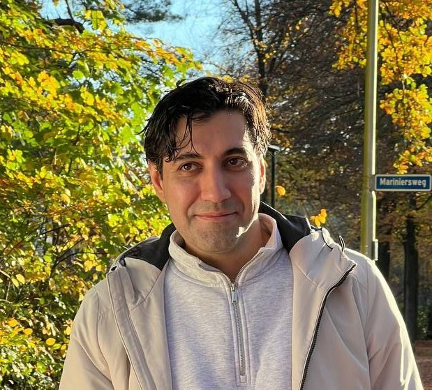

# Vahid Jahandideh

I'm a postdoctoral researcher in the [Digital Security group at Radboud University](https://www.ru.nl/dis/), working with [Lejla Batina](https://www.cs.ru.nl/~lejla/) on the side-channel security of post-quantum cryptography, with a focus on Kyber/ML-KEM and HQC. I combine power-trace experiments with probabilistic and algebraic analysis to study how implementation leakage can be exploited for key recovery and how countermeasures affect the difficulty of these attacks. My recent work investigates single-trace leakage in ML-KEM key generation and belief-propagation attacks on a first-order masked Kyber implementation. These studies examine how leakage interacts with the mathematical structure of the schemes and what this means for their secure implementation.

My PhD research, supervised by [Lejla Batina](https://www.cs.ru.nl/~lejla/) and [Bart Mennink](https://www.cs.ru.nl/~bmennink/), focused on evaluating and designing masking schemes for side-channel security. I developed algebraic and probabilistic methods for analyzing security in the random probing model and relating it to noisy leakage, with applications to masked AES. I also studied how masked components can be composed securely and developed higher-order deterministic masking constructions that use the randomness in their initial input sharings without consuming fresh randomness during execution. This line of work led to deterministic masked implementations of Ascon.

I'm also part of [CESCALAB](https://cescalab.cs.ru.nl/), which specializes in side-channel analysis and cryptographic implementations.

Before my PhD, I was a researcher at [Sharif University in Iran](https://en.sharif.edu/).

## Thesis and résumé

My PhD defense will take place in **November 2026**. [Read my thesis (PDF)](thesis.pdf).

[Download my résumé (PDF)](Vahid_Jahandideh_resume.pdf).

## Publications

- Vahid Jahandideh, Lejla Batina, [Breaking First-Order Masked Kyber with Belief Propagation Alone](https://eprint.iacr.org/2026/2448). Cryptology ePrint Archive, Paper 2026/2448. Preprint. (2026)
- Vahid Jahandideh, [Too Small to Hide: Single-Trace Key Recovery from ML-KEM Key Generation](https://eprint.iacr.org/2026/2137). Cryptology ePrint Archive, Paper 2026/2137. Accepted at [ACTIVE 2026](https://active.cs.ru.nl/2026/). [DOI](https://doi.org/10.1145/3847162.3849237).
- Vahid Jahandideh, Bart Mennink, Lejla Batina, [Leakage-Diagrams, Importance Sampling, and Composition in the Random Probing Model](https://eprint.iacr.org/2026/444). Cryptology ePrint Archive, Paper 2026/444. Accepted for CHES 2027.
- Vahid Jahandideh, Bart Mennink, Lejla Batina, [A Decomposition Approach for Evaluating Security of Masking](https://link.springer.com/chapter/10.1007/978-981-95-5018-0_19), Advances in Cryptology – ASIACRYPT. (2025) 
- Vahid Jahandideh, Bart Mennink, Lejla Batina, [Probing Secure Composability Without Fresh Randomness: Theory and Application to Ascon](https://tches.iacr.org/index.php/TCHES/article/view/12435/12163), IACR Transactions on Cryptographic Hardware and Embedded Systems. (2025) 
- Vahid Jahandideh, Jan Schoone, Lejla Batina, [Clustering Approach for Higher-Order Deterministic Masking](https://eprint.iacr.org/2025/273). Cryptology ePrint Archive, Paper 2025/273. Preprint. (2025)
- Vahid Jahandideh, Bart Mennink, Lejla Batina, [An Algebraic Approach for Evaluating Random Probing Security With Application to AES](https://tches.iacr.org/index.php/TCHES/article/view/11806), IACR Transactions on Cryptographic Hardware and Embedded Systems. (2024)
- Vahid Jahandideh, Léo Weissbart, Bart Mennink, Lejla Batina, [A New Leakage Exploitation Framework and Its Application to Authenticated Encryption](https://csrc.nist.gov/csrc/media/Events/2023/lightweight-cryptography-workshop-2023/documents/accepted-papers/05-a-new-leakage-exploitation-framework.pdf). NIST Lightweight Cryptography Workshop. (2023)
- Vahid Jahandideh, [Concrete Evaluation of the Random Probing Security](https://eprint.iacr.org/2021/859). IACR Cryptol. ePrint Arch. (2021)
- Vahid Jahandideh, [Verification of the security in Boolean masked circuits](https://eprint.iacr.org/2021/860). IACR Cryptol. ePrint Arch. (2021)
